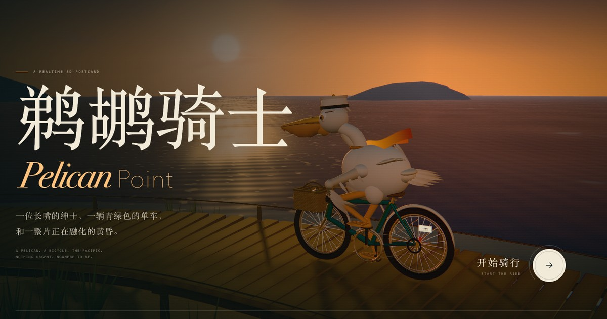

# 鹈鹕骑士 · Pelican Point

A realtime 3D postcard: one pelican, one teal bicycle, and the last forty minutes of a Pacific sunset. Every sky, wave, feather, wicker strand and lighthouse brick is generated in the browser — there are no model files, photo textures, or audio samples.

**Live page: [dxeledx.github.io/pelican-point](https://dxeledx.github.io/pelican-point/)**



## The ride

- **W / S** — accelerate and brake
- **A / D** — lean, steer and change lane
- **Shift** — sprint
- **Space** — hop
- **B** — ring the brass bell
- **H** — honk at the horizon
- **C** — cinema mode
- **P** — download a framed photograph
- **Drag / wheel / pinch** — orbit and zoom
- **Double click** — return to the director's camera

Click the pelican, its bell, or the fish in the basket. The time slider scrubs a handmade day/night palette.

The soundtrack, including surf, wind, gulls, the bell, the pelican and the soft score, is synthesized live with the Web Audio API. The six-second film button records the canvas together with that audio.

## Technical notes

- Three.js r180 (vendored, no CDN dependency at runtime)
- Custom GLSL for the sky, ocean, lighthouse beam and cloth
- Procedural rigging and IK for wings and legs; a two-bone solve keeps the pelican's feet on the pedals
- Sun-aware director camera, portrait-aware framing, orbit/zoom controls with inertia
- EffectComposer bloom, custom grade, tone mapping, MSAA, adaptive pixel-ratio fallback
- Procedural textures generated with Canvas 2D; PBR materials lit by a dynamic atmosphere
- Web Audio soundscape; MediaRecorder film capture; Canvas PNG postcard capture
- Keyboard, touch controls, reduced-motion support and a native accessible dialog

## Run locally

This is a dependency-free static site. From this folder:

```sh
python3 -m http.server 4173
```

Then open <http://127.0.0.1:4173>.

For a shareable snapshot:

- `?quality=high`
- `?ride=1` (starts without a user click; useful for screenshots)
- `?hour=20.5` (start at a different time of day)

---

Made with Three.js, custom GLSL, Web Audio, Canvas and an affection for long-beaked birds.
